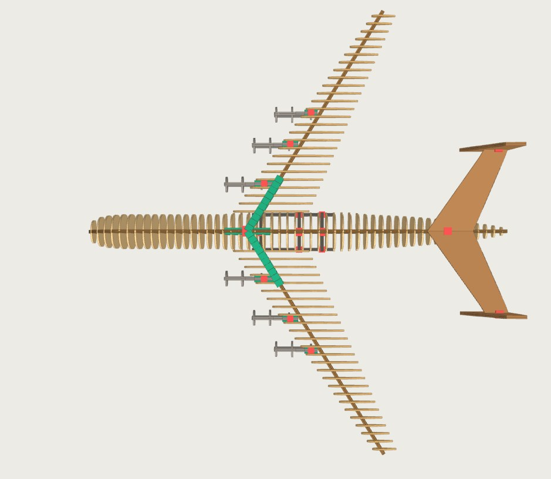
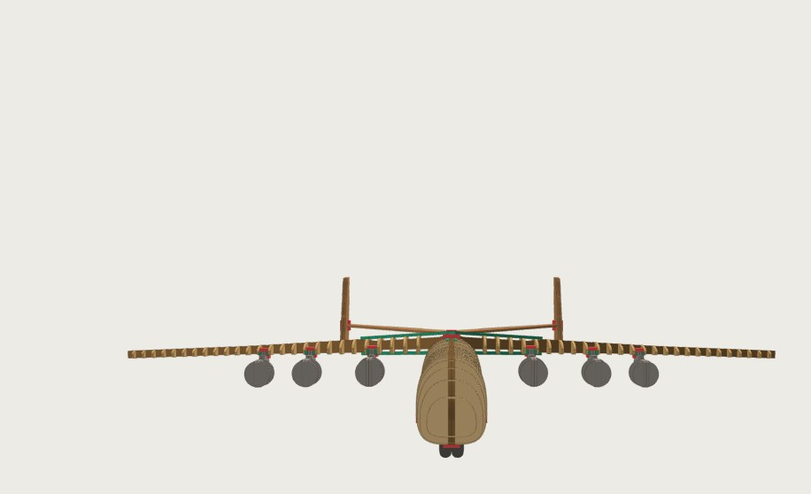

# An-225 Mrija – model z překližky, konstrukce „rybí kostra“

Parametrický 3D model letadla Antonov An-225 Mrija pro výrobu z 3mm překližky na CNC frézce.
Živý náhled: **https://miloslavpansky.github.io/an225-mriya-model/**
(nastavení se ukládá do URL, odkaz lze poslat dál; diskuse v [Discussions](../../discussions), úkoly v [Issues](../../issues)).


## Stav projektu (k 23. 11. 2026)

| Oblast | Stav |
|---|---|
| Koncept konstrukce | odsouhlaseno – rybí kostra: páteř + příčná žebra, křídla/ocas/gondoly/podvozek nasazené na páteř |
| Silueta | upravena podle fotografie UR-82060; přesnost omezená (perspektivní foto, ne výkres) |
| Materiál | 3mm překližka (doporučen topol, alternativně bříza); karton opuštěn |
| Výroba | CNC fréza, pracovní plocha 1000 × 650 mm |
| 3D vizualizace | hotovo (tento repozitář) |
| Výrobní podklady (DXF) | **nezačato** – čeká na vstupy, viz Otevřené body |

## Rozměry a měřítko

| Parametr | Skutečnost | Model (délka 80 cm, 1:105) |
|---|---|---|
| Délka | 84,0 m | 800 mm |
| Rozpětí | 88,4 m | 842 mm |
| Výška (SOP) | 18,1 m | 172 mm |
| Šířka trupu | 7,0 m | 67 mm (+ kryty podvozku) |
| Výška trupu | ~8,4 m (odhad z fotky) | ~80 mm |
| Plocha křídla | 905 m² | – |
| Gondola Ø × délka | ~3,2 × 8 m | 31 × 76 mm |

Souřadnice v kódu: metry skutečného letadla, `x` od špičky přídě, `y` do strany, `z` od země.

## Konstrukce

### Páteř
- 2 vrstvy (2 × 3 mm), při délce ≤ ~95 cm z jednoho kusu.
- Hřebenové spoje se žebry: páteř zářez shora do 40 % výšky, žebro zespodu do 60 % → souvislý pás páteře 60 %.
- Případné dělení páteře vždy mezi dvěma žebry, spoje vrstev vystřídané.
- V místě nosníku křídla příložky z obou stran (±4,5 m skut.), zářez shora na celou výšku nosníku (~17 mm), nosník se neprořezává.
- Pod výškovkou mělké vybrání pro výškovku; žebra pod výškovkou seříznutá → výškovka podepřena po celé hloubce.

### Křídlo – nosník jako I-profil (jeden díl, vkládá se shora)
- **Stojiny**: svislé, 2 vrstvy na každé křídlo, levá a pravá se v ose stýkají pod úhlem ~117° (šíp osy nosníku 31°).
- **Pásnice**: horní a dolní, vodorovné, každá jeden díl tvaru V přes osu až za vnitřní motory; přenáší ohyb přes osu. V ose mírně ohnuté (záporná vzepjatost ~3,4° na každou stranu).
- Sestavení na rovné podložce s úhlovou šablonou → vložení shora do páteře.
- Nosník leží v 35 % hloubky profilu.

### Žebra křídla
- Pravidelný rozestup (shodný se žebry trupu).
- Od trupu po vnitřní motor **půlžebra** (přední + zadní) lepená na stojinu (kvůli pásnicím); dál celá žebra nasazená hřebenem na nosník.
- Minimální výška profilu 10 mm (konce křídla by jinak vyšly ~4 mm).

### Gondoly
- Podélný profil + pylon, 2 vrstvy; 3 prstence nasazené hřebenem.
- Polohy motorů posunuty tak, aby pylon vyšel přesně **mezi dvě sousední žebra**. Jazýček pylonu se lepí mezi ně, mezera (rozestup − tloušťka) se vyplní výplňovými vrstvami. Nosník se pro motor neprořezává.

### Ocasní plochy
- Výškovka jedna vrstva, jeden díl přes celé rozpětí (~311 mm), mírná kladná vzepjatost.
- Kýlovky 2 vrstvy, bez žeber (6 mm ≈ skutečná tloušťka v měřítku), přesah ~3,3 m pod výškovku.
- Spoj kýlovka–výškovka: vodorovný zářez v kýlovce **od odtokové hrany**, kýlovka se nasouvá dopředu na konec výškovky.

### Podvozek (zdvojený)
- 3 příčníky mezi žebry trupu, zářez zespodu do páteře (25 %), v těchto místech páteř nemá zářez shora.
- 2 podélné pásy se 7 koly, křížové zářezy s příčníky.
- Příďová noha zdvojená, zářez do páteře.

### Pravidla spojů
- Všechny spoje jsou **hřebenové** (zářez od hrany) – žádné vnitřní výřezy.
- Šířka zářezu = naměřená tloušťka desky + ~0,1 mm.
- Fréza max. Ø 2 mm (3,175 mm je na 3mm zářez široká), odlehčení rohů (dog-bone) R 1 mm.
- Vlákno krycí dýhy podél páteře, stojin a kýlovek.

## Odmítnuté / změněné varianty (historie rozhodnutí)
1. Vodorovné vrstvy (stohování) → nahrazeno rybí kostrou.
2. Výztuha páteře na ocase → zbytečná, odstraněna.
3. Dva samostatné nosníky křídel → nahrazeno jedním průběžným dílem vkládaným shora.
4. Karton s rýhovaným ohybem nosníku → u překližky nelze, nahrazeno I-profilem s pásnicemi.
5. Žebra kýlovek → u překližky zbytečná.
6. Zářez kýlovky od náběžné hrany → nevyplněný úsek, nahrazeno zářezem od odtokové hrany.
7. Formát A4 (karton) → stůl frézy 1000 × 650 mm.

## Otevřené body
- [ ] Cílová délka modelu (výchozí 80 cm).
- [ ] Naměřená tloušťka překližky.
- [ ] Průměr frézy.
- [ ] Rozestup žeber (15 mm vs. 18–20 mm – méně dílů a strojního času).
- [ ] Přesnější silueta – ideálně bokorys/půdorys (výkres 3 pohledů).
- [ ] Generátor DXF: díly s číslováním, zářezy, dog-bone, rozmístění na desky 1000 × 650 mm, úhlová šablona nosníku.
- [ ] Návod ke stavbě (pořadí lepení).

## Struktura repozitáře
```
index.html        stránka (GitHub Pages)
js/model.js       parametrická geometrie (silueta, díly, spoje) – bez závislosti na three.js
js/app.js         UI, 3D render (three.js r128 z cdnjs), bokorys/půdorys, URL stav
docs/img/         náhledy
CLAUDE.md         kontext pro Claude Code
```

## Lokální spuštění
Stačí otevřít `index.html` v prohlížeči (nebo `python3 -m http.server`).

## Galerie
| | |
|---|---|
|  |  |
|  |  |
|  |  |
|  | |
