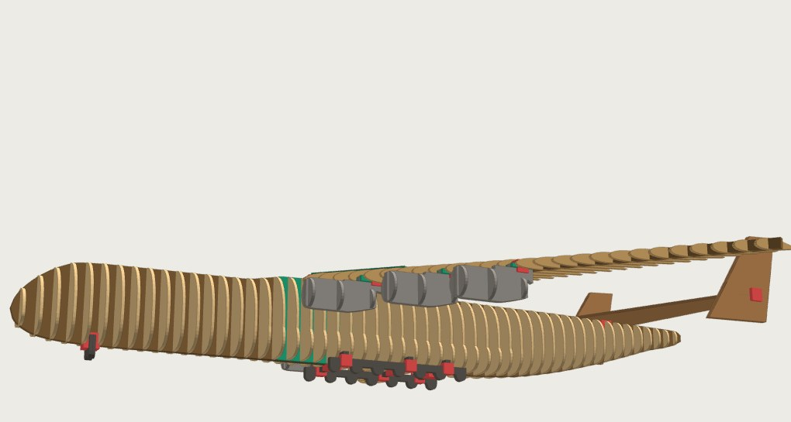
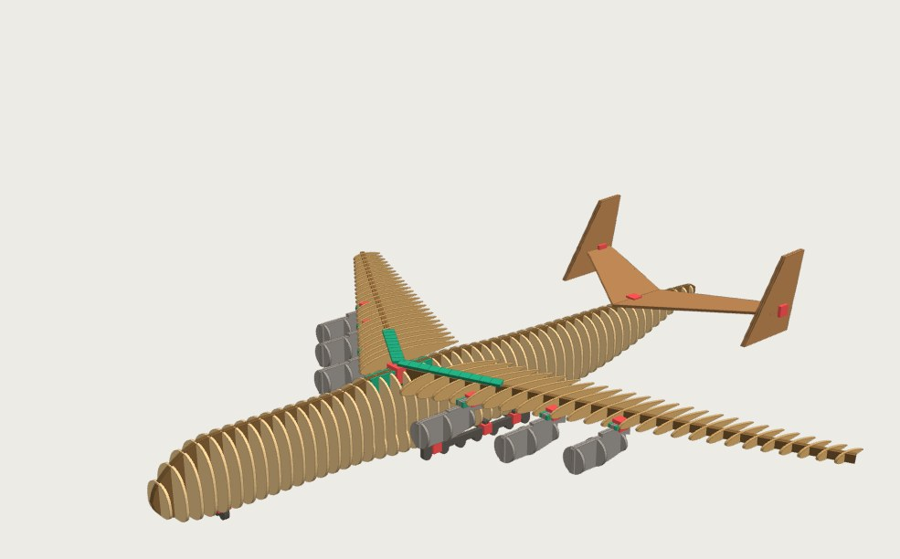
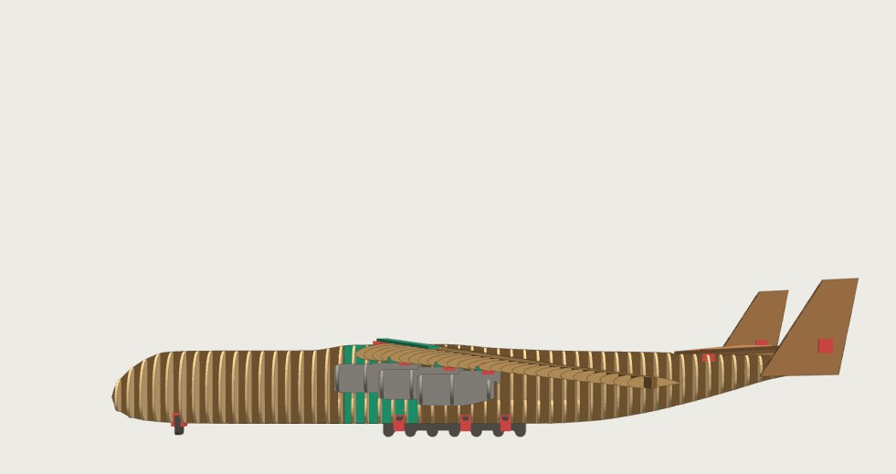
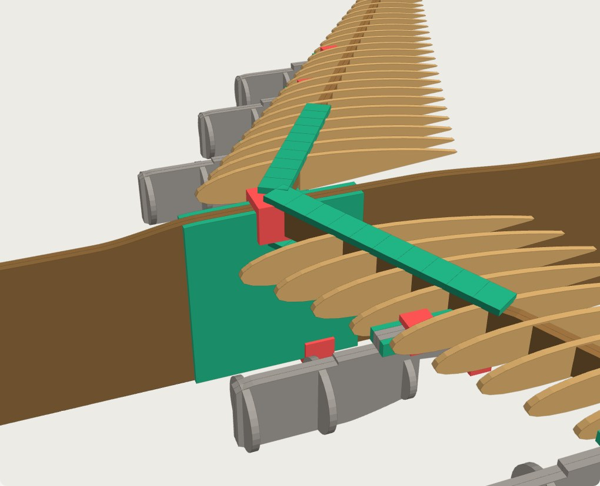
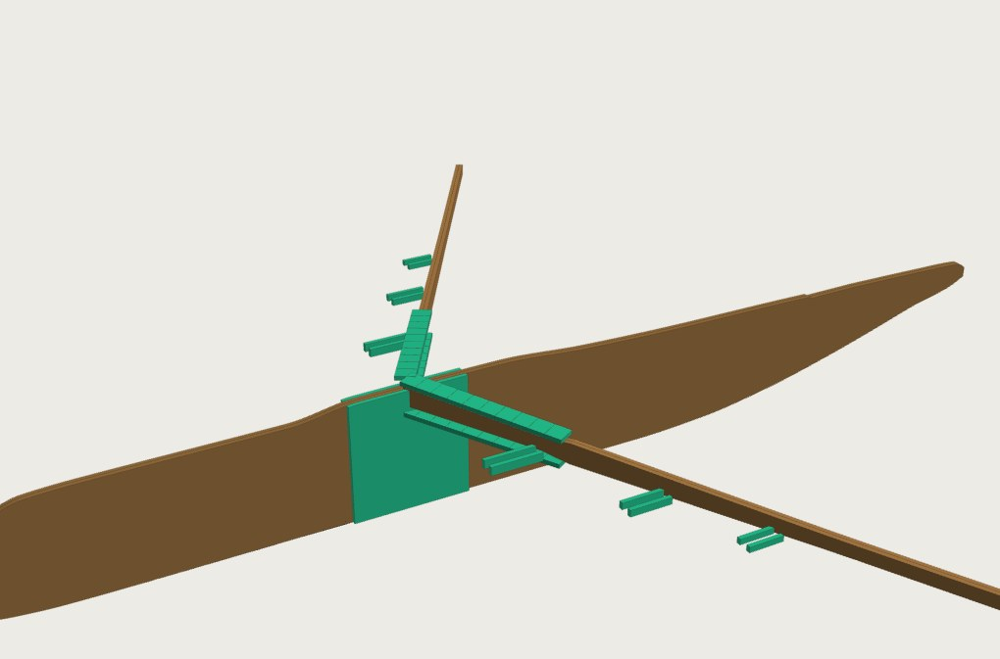
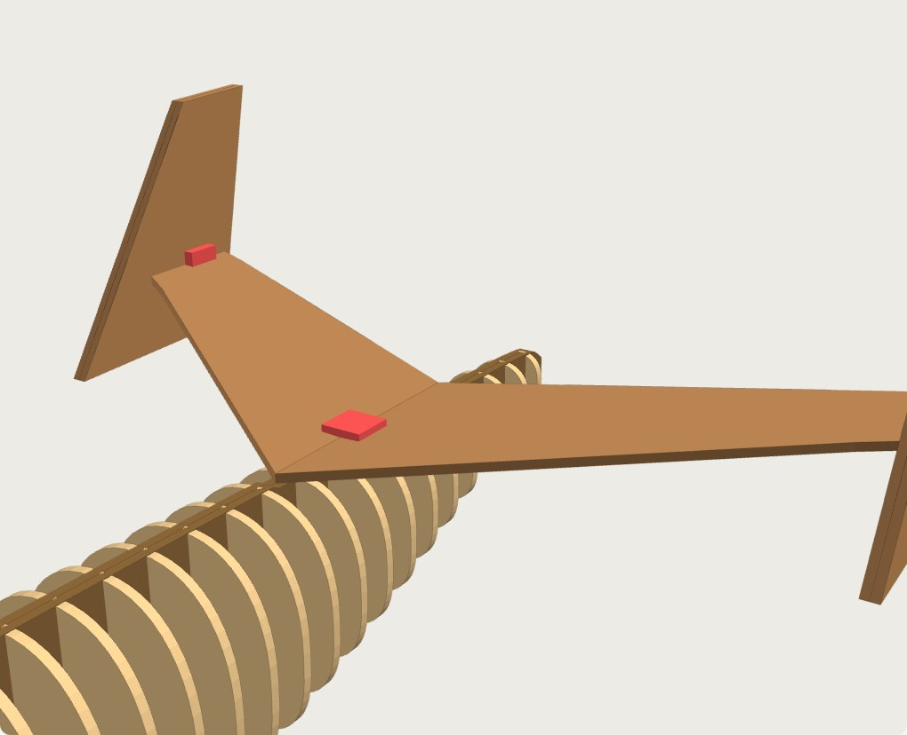

# An-225 Mrija – model z překližky, konstrukce „rybí kostra“

Parametrický 3D model letadla Antonov An-225 Mrija pro výrobu z 3mm březové překližky na CNC frézce.
Živý náhled: **https://miloslavpansky.github.io/an225-mriya-model/**
(nastavení se ukládá do URL, odkaz lze poslat dál; diskuse v [Discussions](../../discussions), úkoly v [Issues](../../issues)).


<sub>Náhledy v `docs/img/` jsou ze stavu před úpravou geometrie podle výkresu.</sub>

## Stav projektu (k 28. 11. 2026)

| Oblast | Stav |
|---|---|
| Koncept konstrukce | odsouhlaseno – rybí kostra: páteř + příčná žebra, křídla/ocas/gondoly/podvozek nasazené na páteř |
| Účel | **hračka pro 8letého syna** – nelétá; robustní v místech namáhaných ohybem, nedimenzováno na pády |
| Geometrie | **podle výkresu 3 pohledů** (bokorys, půdorys, nárys, 9 řezů trupu, profily křídla) – data s původem v [`js/an225-ref.js`](js/an225-ref.js), postup v [`tools/digitize/`](tools/digitize/) |
| Materiál | **3mm bříza** (BB/BB, EN 636-2, emisní třída E1); topol a karton opuštěny |
| Výroba | CNC fréza, pracovní plocha 1000 × 650 mm, fréza Ø2 mm |
| 3D vizualizace | hotovo; mapa namáhání (5 zatěžovacích stavů + obálka), výkres jako podklad bokorysu/půdorysu; automatický test a nasazení přes GitHub Actions |
| Výrobní podklady (DXF) | **nezačato** – další krok |

## Rozměry a měřítko

| Parametr | Skutečnost | Model (délka 80 cm, 1:105) |
|---|---|---|
| Délka | 84,0 m | 800 mm |
| Rozpětí | 88,4 m | 838 mm (koncové žebro 4 mm před zaobleným koncem) |
| Výška (SOP) | 18,1 m | 172 mm |
| Šířka trupu (max., vč. krytů podvozku) | 7,4 m [výkres] | 71 mm |
| Výška trupu | ~8,5 m [výkres] | ~81 mm |
| Hloubka křídla osa / zalomení / konec | 20,6 / 13,8 / 3,9 m | 196 / 131 / 37 mm |
| Vzepětí křídla | −5,6° [nárys] | |
| Gondola Ø × délka | 3,0 × 7,6 m | 29 × 72 mm |

Souřadnice v kódu: metry skutečného letadla, `x` od špičky přídě, `y` do strany, `z` od země.
Všechny rozměry letadla jsou v `js/an225-ref.js` se značkou původu (oficiální / bokorys / půdorys / nárys / řez / profil / dopočteno / odhad).

## Konstrukce

### Páteř
- 2 vrstvy (2 × 3 mm), při délce ≤ ~95 cm z jednoho kusu.
- Hřebenové spoje se žebry: páteř zářez shora do 40 % výšky, žebro zespodu do 60 % → souvislý pás páteře 60 %.
- Případné dělení páteře vždy mezi dvěma žebry, spoje vrstev vystřídané.
- V místě nosníku křídla má páteř zářez shora, do kterého se v ose potkají obě stojiny nosníku (Λ) i spodní spojka. Příložky páteře zrušeny (26. 11.).
- Hřbet pod kořenem výškovky dorovnán k její spodní ploše → výškovka podepřena po celé hloubce kořene.

### Trup
- Tvar žeber z řezů 1-1 … 9-9 výkresu (normalizovaný tvar, mezi řezy plynulé prolnutí), výška z bokorysu, šířka z půdorysu.
- **Boční podélníky** (K5): vodorovné pásy 10 mm ve výšce 3,8 m (skut.), od přídě po ~66 m, zasunuté do bočních zářezů žeber → každé žebro drženo ve 3 bodech.

### Křídlo – nosník Λ, rybí kost (stav 28. 11.)
Výkresy dílů: [`docs/parts/`](docs/parts/) (generuje `node tools/parts/sheets.mjs`). Každý díl je plochá deska plné tloušťky (2D fréza).
- **Stojina** každého křídla je **jeden díl ve 2 vrstvách od osy trupu po koncové žebro**, bez zářezů, ve svislé rovině podél přímé šípové osy (35 % hloubky v ose → 42 % u konce, šíp 26°). Vzepětí 5,6° je jen lom obrysu desky na kořenovém žebru (uvnitř trupu je křídlo bez vzepětí). Uvnitř trupu je stojina **hluboká** (54 mm, 8 mm od obrysu trupu, nad bočními podélníky). Na kořenovém žebru tak není žádný spoj na tupo.
- **V ose** se obě stojiny potkají ve tvaru **Λ** v zářezu páteře a drží je:
  - **horní pásnice** – jeden díl Λ přes celé rozpětí (838 × 230 mm), ohyb 5,6° na obou kořenových žebrech; nese tah při tlaku na konce křídel dolů,
  - **spodní spojka** – pás 10 × 3 mm ve tvaru Λ přilepený zespodu na ploché spodní hrany hlubokých stojin; nese tah při zvedání konců křídel.
- **Dolní pásnice** – 2 díly, každý od kořenového žebra ke konci, bez ohybu (uvnitř trupu by musela proříznout hlubokou stojinu, nahrazuje ji tam stojina + spodní spojka).
- **Pásnice** 1 vrstva, šířka 20 mm u kořene → 12 mm u konce. Přilepené po celé délce na hranu stojiny (smyk v lepeném spoji ~0,3 MPa) a **zapuštěné do loží žeber** (líc = obrys profilu). **Obdélníkové výřezy 5 × 3 mm z obou okrajů** u každého žebra: žebro jimi prochází v plné výšce a zapadne do nich (šířka 5 mm pokrývá šikmé křížení o 26°). Plné jádro pásnice 14 → 6 mm.
- **Žebra**: pravidelně 25 polí po 15,2 mm, všechna (i kořenové) jako **přední + zadní půlžebro** lepené na stojinu, s loží pro jádro pásnic a pro lištu. **Konec křídla uzavírá celé koncové žebro** (43,8 m) s plným profilem – stojina i pásnice končí na jeho vnitřní ploše.
- **Pomocná lišta**: rovný pás 10 × 3 mm bez zářezů, zespodu za nosníkem, od 65 % hloubky kořenového žebra do 27,9 m, zapuštěná do loží zadních půlžeber.
- Zrušeno: centroplán s kýlem (26. 11.), 2. vrstva pásnic ±6 m (K2), příložky páteře.
- Profil podle řezů výkresu (max. tloušťka ve 40 %), relativní tloušťka 12 % → 10 %; **min. tloušťka profilu 12 mm**, **odtoková hrana tupá ≥ 3 mm** (G6).

### Gondoly
- **Gondola + pylon** 2 vrstvy, motor vždy přesně mezi dvěma žebry. Pylon se **nasazuje zespodu**: horní okraj má výřez pro nosník (dosedá na dolní pásnici) a dva jazýčky na celou výšku profilu před a za nosníkem, mezera k žebrům vyplněna výplněmi. **Spoj se musí slepit** (tření nestačí). Zadní jazýček má lože pro pomocnou lištu.
- **Náběžná hrana pylonu** plynule přechází z horní strany gondoly do náběžné hrany křídla (dříve ostrý roh 1 m před náběžnou hranou).
- **Prstence 1 vrstva**, 5 na gondolu v rozestupu žeber (15,2 mm). **Spoj 50/50**: prstenec má výřez shora do osy, gondola výřez zdola do osy.

### Ocasní plochy
- **Výškovka 2 vrstvy** (K6), jeden díl přes celé rozpětí, vodorovná (podle nárysu).
- Kýlovky 2 vrstvy podle bokorysu, včetně části pod výškovkou.
- Spoj kýlovka–výškovka: vodorovný zářez v kýlovce **od odtokové hrany** + **2 trojúhelníkové výztuhy 25 mm** z vnitřní strany nad a pod výškovkou (K7).

### Podvozek (zdvojený)
- 2 podélné pásy se 7 koly (polohy a Ø podle bokorysu), ve vzdálenosti ±2,6 m, **zasazené hřebenem do žeber trupu** v oblasti podvozku (K10) – zatížení nesou žebra.
- 3 příčníky mezi žebry (doplňkové), příďová noha zdvojená.

### Pravidla spojů a výroby (M4, M5)
- Všechny spoje jsou **hřebenové** (zářez od hrany) – žádné vnitřní výřezy.
- Šířka zářezu = **naměřená** tloušťka desky + 0,1 mm (měřit každou desku); před výrobou zkušební hřebínek s šířkami +0 až +0,3 mm.
- Materiál mezi zářezem a okrajem ≥ 2 × tloušťka; nejužší místo dílu ≥ 5 mm (kontroluje test); vnější rohy R ≥ 1,5 mm; vstup do zářezu zkosit 0,5 mm.
- Fréza Ø2 mm **downcut** (netrhá horní dýhu), odlehčení rohů (dog-bone) R 1 mm, můstky (tabs) u malých dílů, deska upnutá po celé ploše.
- Pravidla jsou v kódu jako `AN225.RULES` (`js/model.js`).

## Namáhání (orientační výpočet, `js/stress.js`)
Prutová teorie; bříza: ohyb 40 MPa, lepený spoj na odtržení 2 MPa. Zatěžovací stavy pro hraní 8letého dítěte:
křídlo 30 N na konec, ocas 25 N svisle na každou kýlovku, kýlovka 20 N bočně, motor 50 N bočně, podvozek 100 N.

| Místo (využití = napětí / dovolené) | Původní návrh | Po úpravách |
|---|---|---|
| Křídlo – nejslabší průřez nosníku (~20 cm od osy, v místě výřezů) | 704 % (stojina se zářezy) | 78 % |
| Křídlo – u boku trupu / v ose | – | 40 % / 9 % (hluboká stojina + spodní spojka) |
| Lepení jazýčku vnějšího pylonu | 737 % | 85 % |
| Spoj kýlovka–výškovka | 274 % | 80 % |
| Příčník podvozku | 98 % | ~0 % (nesou žebra) |
| Výškovka u trupu | 72 % | 14 % |
| Páteř – ocasní část | – | 20 % |

## Odmítnuté / změněné varianty (historie rozhodnutí)
1. Vodorovné vrstvy (stohování) → nahrazeno rybí kostrou.
2. Výztuha páteře na ocase → zbytečná, odstraněna.
3. Dva samostatné nosníky křídel → nahrazeno jedním průběžným dílem vkládaným shora.
4. Karton s rýhovaným ohybem nosníku → u překližky nelze, nahrazeno I-profilem s pásnicemi.
5. Žebra kýlovek → u překližky zbytečná.
6. Zářez kýlovky od náběžné hrany → nevyplněný úsek, nahrazeno zářezem od odtokové hrany.
7. Formát A4 (karton) → stůl frézy 1000 × 650 mm.
8. Silueta z fotografie → **výkres 3 pohledů** (G1–G6).
9. Topol → **bříza** (M1).
10. Stojina se zářezy pro celá žebra za vnitřním motorem → **průběžný I-nosník bez zářezů, všechna žebra jako půlžebra** (K1–K3).
11. Výškovka 1 vrstva → **2 vrstvy** (K6).
13. Křídlo (26. 11.): spojka pásnic a příložky páteře → **kýl centroplánu** (vyšší nosník v trupu); pásnice na žebrech → **zapuštěné se zářezy**; otevřený konec → **koncové žebro**; pásnice zúžená ke konci; lišta se zářezy; pylon nasazovaný zespodu s plynulou náběžnou hranou; prstence 1 vrstva v rozestupu žeber se spojem 50/50.
14. Křídlo (28. 11.): pásnice a lišta se zářezy → **jednoduché pásy bez zářezů** v ložích žeber (jako podélníky trupu), pásnice 16 → 10 mm, lišta rovná; ve 3D se nezobrazují spoje (díly se nenapojují, jen laminují).
15. Kořen (28. 11.): centroplán s příčnou stojinou a stojiny vnějších křídel na tupo pod úhlem 26° → **stojina každého křídla 1 díl od osy, Λ v ose, průběžná horní pásnice, spodní spojka**; pásnice znovu s výřezy pro žebra, nyní obdélníkovými 5 × 3 mm.
12. Zvažováno a zamítnuto (mění vzhled rybí kosti nebo není potřeba): plné vrstvené křídlo, plný konec křídla, vrstvená gondola, pojízdný podvozek, rozestup žeber 18 mm, předepsaný směr vlákna a křížení vrstev (M2, M3), bezpečnostní úpravy hračky (B1–B3).

## Otevřené body
- [ ] Naměřená tloušťka březové překližky (šířka zářezů).
- [ ] Ohyb horní pásnice 5,6° na kořenových žebrech – ověřit na zkušebním kusu.
- [ ] Zářez páteře pro Λ stojin a spodní spojku – rozměry vyřeší generátor DXF.
- [ ] Detaily trupu, ocasu a podvozku (další kroky ladění).
- [ ] Odhady v `js/an225-ref.js` označené [E] (rozchod podvozku, sklon kýlovek, délka gondol, tloušťka profilu u konce).
- [ ] Generátor DXF: díly s číslováním, zářezy z průniků dílů, dog-bone, rozmístění na desky 1000 × 650 mm, šablona ohybu pásnice.
- [ ] Návod ke stavbě (pořadí lepení).

## Struktura repozitáře
```
index.html                   stránka (GitHub Pages)
js/an225-ref.js              referenční geometrie z výkresu (s původem každé hodnoty)
js/model.js                  parametrická geometrie (díly, spoje, pravidla RULES) – bez závislosti na three.js
js/stress.js                 orientační výpočet namáhání + barevná škála
js/app.js                    UI, 3D render (three.js r128 z cdnjs), mapa namáhání, bokorys/půdorys s podkladem, URL stav
tests/model.test.mjs         kontrola geometrie v Node (polygony, díly ≤ stůl − 20 mm, min. šířka 5 mm, namáhání)
tests/smoke.sh               kouřový test stránky v headless Chrome + snímek
tools/digitize/              skripty pro odečet z výkresu (Python + Pillow)
tools/parts/sheets.mjs       výkresové listy upravených dílů → docs/parts/*.svg
.github/workflows/pages.yml  CI: test → build → deploy na GitHub Pages
docs/img/                    náhledy (stav před úpravou podle výkresu)
docs/parts/                  výkresy dílů křídla a gondol (SVG)
CLAUDE.md                    kontext pro Claude Code
```

## Lokální spuštění
Stačí otevřít `index.html` v prohlížeči (nebo `python3 -m http.server`).
Test geometrie: `node tests/model.test.mjs`.

## CI / nasazení
Každý push do `main` spustí workflow **Pages** (`.github/workflows/pages.yml`):
1. kontrola syntaxe JS a geometrie (`tests/model.test.mjs`) – při chybě se nenasazuje,
2. sestavení `_site` – do patičky se vloží verze (commit + čas), skripty dostanou `?v=<commit>` proti cache,
3. kouřový test v headless Chrome (model se musí vykreslit), snímek se uloží jako artefakt `preview`,
4. nasazení na GitHub Pages (zdroj Pages = GitHub Actions).

Pull requesty do `main` se jen testují. Ruční spuštění: Actions → Pages → Run workflow.

## Galerie (stav před úpravou podle výkresu)
| | |
|---|---|
|  |  |
|  |  |
|  |  |
|  | |
